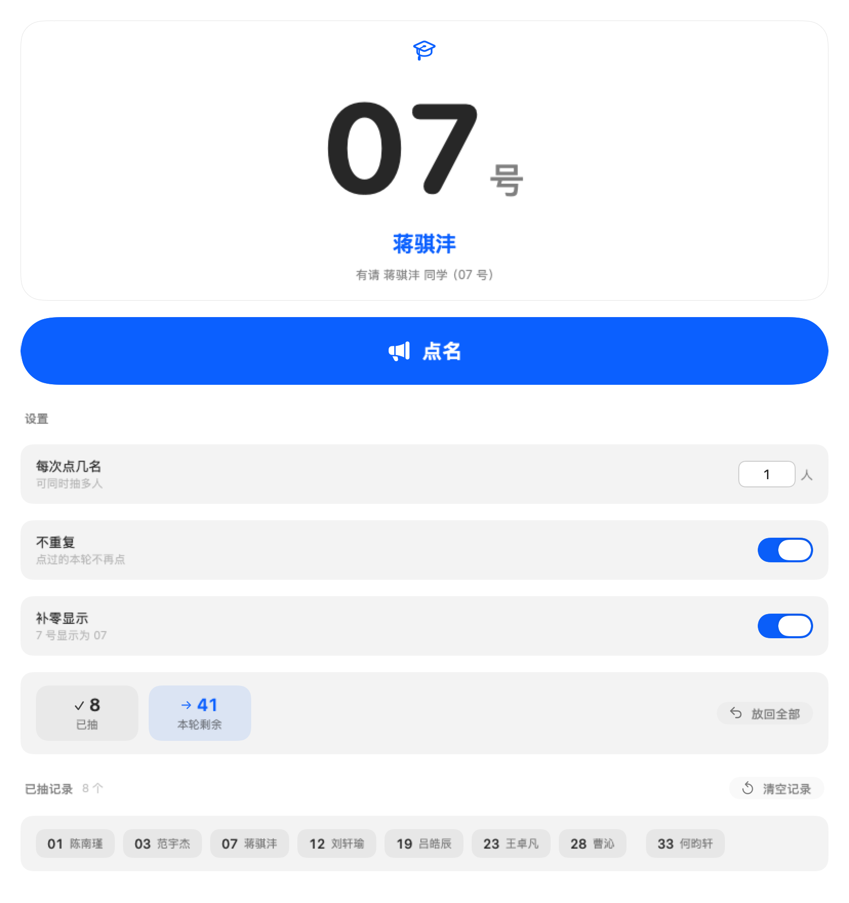
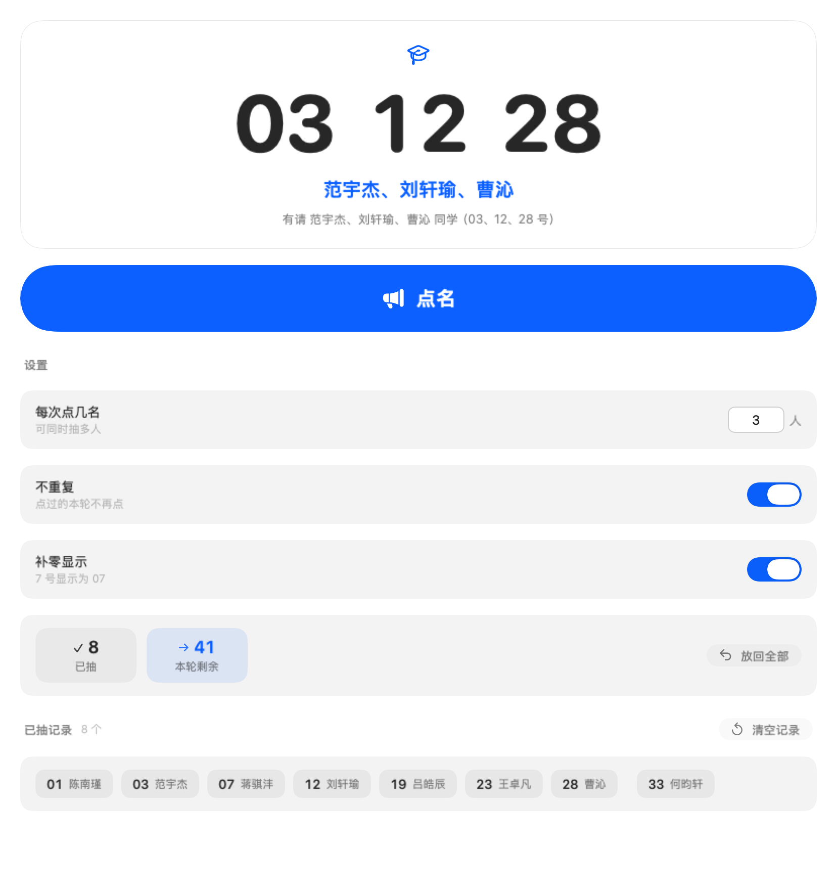
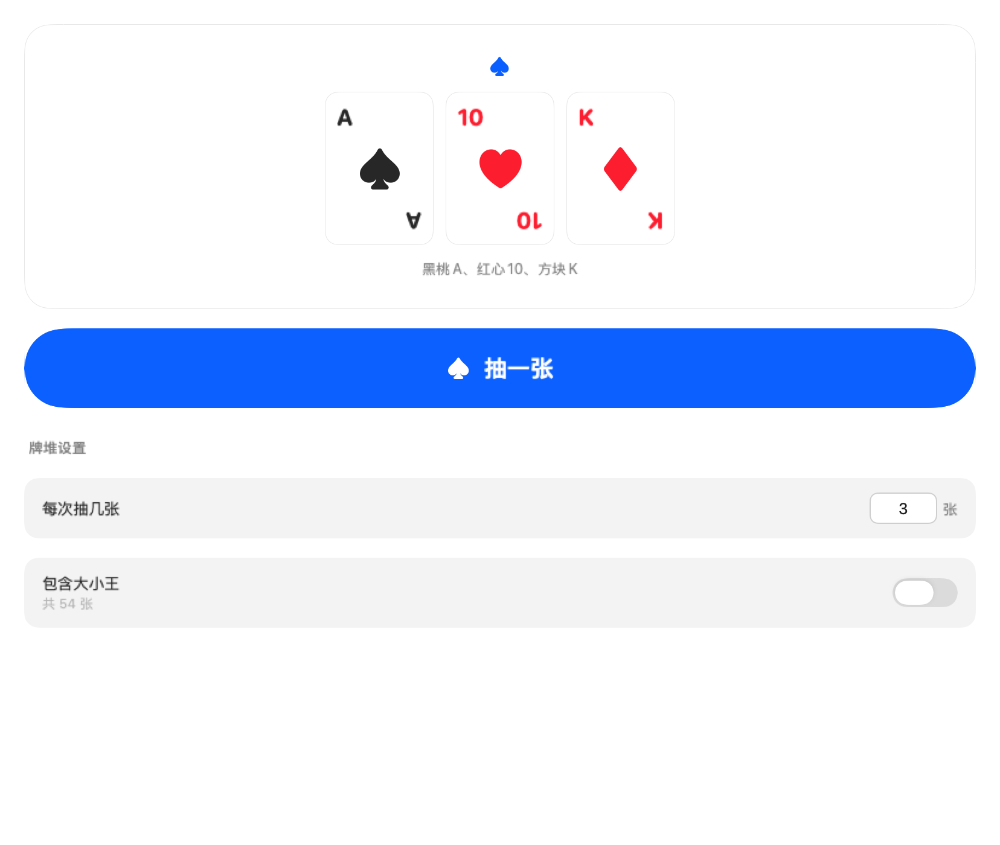
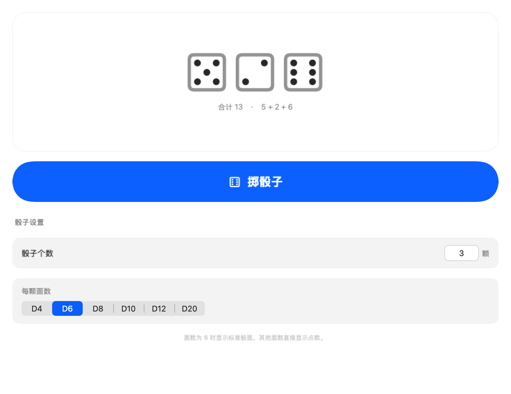

# Random · 班级随机工具

用 **Xcode 构建的原生 SwiftUI macOS 应用**。导入自己的花名册后，每个班各占侧边栏独立一栏，抽号与点名合并成一件事，记录各记各的、关掉也留着。**应用不内置任何名单**，谁都能拿来用。

- **工程**：`Random.xcodeproj`（Xcode 打开，⌘R 运行）
- **应用**：`/Applications/Random.app`
- **标识**：`cn.renqiaoyi.random` · 3.2 (34) · 最低 macOS 14.0
- **名单**：外部 `.randomroster` 文件（双击 / 拖进窗口 / 设置页导入），详见「〇、名单导入」
- **纯单机**：数据只存本机，不联网、不传服务器
- **ad-hoc 已签名**（自用无碍，见「十二、签名与日常使用」）· 音效可选 · 无内购
- 界面走 **macOS 原生**：系统侧边栏 / 分组卡片 / 系统按钮，不自绘玻璃（见「3.2」）
- **窄于 800pt 自动收起边栏；宽回来不会自动弹出**，要手动点工具栏按钮（见「八」）

## 截图

| 课堂抽号 | 多人同时抽 |
|---|---|
|  |  |

| 抽卡 | 骰子 |
|---|---|
|  |  |

<sub>更多截图见 [`Docs/`](Docs)</sub>

---

## 〇、名单导入（第一次打开必须做）

应用**不内置任何班级**，首次打开是空状态（侧边栏「班级 → 尚未导入」），
先导入一份 `.randomroster` 名单才能点名。三种方式任选：

| 方式 | 操作 |
|---|---|
| 双击文件 | 双击 `.randomroster`（或拖到 Dock 上的 Random 图标） |
| 拖进窗口 | 把文件拖进 Random 窗口 |
| 应用内 | 工具栏「导入名单」 / 设置页 ⌘, → 名单来源 → 导入 |

导入后自动记住，下次打开直接用；换名单就「重新导入」，不想留就「移除名单」。
落盘在 `~/Library/Application Support/cn.renqiaoyi.random/Imported/active.randomroster`。

**格式**（纯 JSON，UTF-8）：

```json
{
  "name": "湘珺未来学校 2026 春",
  "classes": [
    { "id": "2601", "title": "初一 2601 班", "students": ["张三", { "name": "李四", "no": 2 }] }
  ]
}
```

- `students` 里既可以是**纯姓名字符串**（按数组下标自动编号，从 1 起），
  也可以是 `{"name":…, "no":…}` 指定学号
- `id` 是班内唯一键，重复 / 空 id、空班级都会被拒绝并给出提示

手里的 Excel / CSV 不用手工整理：交给 `random-roster-import` skill
（`~/.workbuddy/skills/random-roster-import/`），它能自动识别
**一个班一张表 / 长表（班级列 + 姓名列）/ 分段标题行**三种排布，直接输出 `.randomroster`。

---

## 一、侧边栏

```
[ 搜索班级或工具 ]

∨ 初三年级           ← 点组头展开 / 收起，默认只展开当前班所在的那组
    2401   10/49     ← 右侧实时显示「已抽 / 全班」
    2402    0/49
    …
    2412    0/49
> 初一年级
    2601 … 2606

随机工具
  随机分组 · 随机数字 · 骰子 · 硬币
  抽卡 · 随机颜色 · 随机字母 · 剪刀石头布 · 是或否

记录
  历史记录   12    ← 徽标是记录条数
```

**每个班是独立入口**，各记各的点名记录，互不干扰。切走再切回来，记录还在。

- **按年级折叠**：18 个班平铺太杂，按「初三 / 初一」分组（年级由班号前两位推算：
  24 级 = 初三、26 级 = 初一），切换班级时只保留当前年级展开。
- **3.0 起侧边栏是自绘的**（`ScrollView + LazyVStack`），不是 `List` —— 原因见
  「3.0 踩坑」第一条，`List` 在 macOS 上插入行**没有**动画。
- 顶部搜索框：班多到十八个时，直接搜班号或「骰」就能筛出来；搜索时所有分组自动展开，
  并**保留当前选中项**，不会因为搜到别的东西把正在看的页面顶掉。

---

## 二、班级页（抽号 + 点名合一）

- 大字显示 **学号**（如 `07`），下面直接跟 **姓名**（如「蒋骐沣」）
- 点 **点名** 或按 **⌘↩** 抽取，**2 秒**滚动后定住
- 播报文案：**「有请 蒋骐沣 同学（07 号）」** —— 要点的是人，不是号
- **可同时抽多人**：设置里「每次点几名」直接填数字（1–10），多人时并列出号与姓名
- **记录持久化**：抽过的号码留在本栏，**关掉应用再打开仍在**，只有主动「清空记录」才抹掉
- 记录以胶囊列出（学号 + 姓名），**点一下就把这个号码放回**，下次还能抽到
- 「放回全部」一键重置本班
- 两个开关：**不重复**（点过的本轮不再点）、**补零显示**（7 号显示为 07）
- 两个数据磁贴：已抽 / 本轮剩余；剩余为 0 时变红提示
- **点名统计（2.0）**：页面底部列出「被点得最少的 6 个人」，0 次的用橙色标出来。
  一学期下来如果总是那几个人被点，这一眼就看得出来。统计只算点名，分组不算。

---

## 三、音效与特效

**音效是程序实时合成的**（`Sound.swift`），不依赖任何音频文件。

**3.3 起，抽取过程的声音跟着工具走**（`ToolSound`）—— 不再是十页共用的「嘟嘟嘟」：

| 工具 | 过程中的声音 | 怎么做的 |
|---|---|---|
| 点名 | 木牌「嗒」 | 短促木质敲击 + 每 5 拍一记沙锤，像手指在花名册上往下点 |
| 随机数字 | 机械计数器「嘀」 | 方波脉冲 + 极短包络，音高随进度微升 |
| 骰子 | 塑料骰子「咔啦」 | 高频噪声爆裂 + 随机音高，模拟骰子在桌面上翻滚磕碰 |
| 硬币 | 金属「叮」 | 非整数倍泛音（1 / 2.76 / 5.40）+ 长衰减，金属在被弹起来 |
| 抽卡 | 洗牌「唰」 | 带通噪声，密度随进度增加 |
| 随机颜色 | 取色器「嘟」 | 正弦短音，柔和无攻击性 |
| 随机字母 | 打字机「嗒」 | 噪声瞬态 + 机械回弹 |
| 猜拳 | 挥拳「呼」 | 低通噪声扫频，三拍之后出拳 |
| 是或否 | 心跳 | 两连低频脉冲（咚—咚） |
| 分组 / 顺序 | 洗牌分堆 | 噪声成串，像牌被分开 |

**落定音分两类**：骰子 / 硬币 / 牌 / 猜拳 / 取色器这些**有实物**的，用自己的落地声（骰子磕桌、硬币颤音、牌拍桌），
也不插上扬音；点名 / 数字 / 字母 / 是或否这些**没有实物**的，仍然用设置里那 25 种落定音。
理由很简单：骰子落地时插一段八音盒，谁听都觉得假。

**彩带特效**：点名 / 抽取落定时在结果卡片里放一次 —— 两侧底部礼炮 + 中心一团烟花 + 扩散光环，粒子带重力、自旋、渐隐，约 2.1 秒。纯 `Canvas` 绘制，不用图片资源。

- 音效**默认开启**，工具栏喇叭按钮或 **⇧⌘M** 一键静音，设置里也能关（带「试听」）
- 关掉后**连音频引擎都不会被创建**，完全不碰音频设备


---

## 四、随机工具

| 工具 | 说明 |
|---|---|
| **随机分组** | **2.0 新增**。全班随机分成若干组：按组数（2–12）或按每组人数（2–20），**各组人数最多差 1 人**；结果按组列出姓名，可一键复制 |
| 随机数字 | 任意范围、最多 20 个；**抽过的不再抽**（默认开，抽满可清空重开），也可关掉做纯随机 |
| 骰子 | 1–8 颗，D4 / D6 / D8 / D10 / D12 / D20 |
| 硬币 | 正反面 + 累计统计，带翻转动画 |
| 抽卡 | 一副 52 张（可加大小王共 54），最多一次 10 张 |
| 随机颜色 | 大色块 + HEX / RGB / HSB，一键复制色值，四档取色范围 |
| 随机字母 | A–Z / A–H / 元音，可切大小写 |
| 剪刀石头布 | 三键出拳，对局 + 胜/负/平战绩（持久化） |
| 是或否 | 大字「是 / 否」，带次数统计（持久化） |

统计类的工具（硬币 / 猜拳 / 是或否）战绩**同样关机保留**。

> **每个工具的过程都长得不一样（3.3）**：硬币真的在翻、骰子真的在滚、牌真的从背面翻开、
> 猜拳真的是两只手在晃、分组真的是几摞牌在桌上洗、点名有一条光带在花名册上扫。
> 连声音也各是各的 —— 骰子咔啦、硬币叮、洗牌唰、点名嗒。详见「三、音效与特效」。

> **随机分组怎么分的**：先洗牌，再「轮流发牌」。50 人分 4 组得到 13/13/12/12，
> 而不是切段分法的 13/13/13/11 —— 后者最后两组只差一个人，换座位时很别扭。
> 分组用的是**全班**，不受「这一轮已经点过谁」影响；页面上可以直接换班。
> 结果可以「复制分组」，粘到班级群里是一行一组的纯文本。

> **随机数字的「抽过的不再抽」**：把范围设成 1–49、个数 1，它就是一台不会撞号的抽号器 ——
> 抽过的号立刻出池，舞台下方会写「还剩 42 个没抽过」，抽满后按钮自动停用，点「清空」重开一轮。
> 需要真随机（掷数游戏）时把开关关掉。

> **落定特效**：每次抽完随机放一种 —— 彩带礼炮 / 连环烟花 / 星芒绽放 / 冲击光环，
> 结果数字同时「弹一下」并带光晕。落定音也从钟声 / 琶音 / 木琴 / 电子里随机挑一个，
> 抽取鼓点每轮换音色、末尾还有一记上扬音。设置页可把风格固定下来。
> 全部实时绘制与合成，零图片 / 零音频素材。

> **投影模式（macOS）**：工具栏最左边那个按钮，一键收起边栏并进全屏，
> 把舞台铺满教室大屏；再点一次退出。

> **所有「几个 / 几张 / 几颗」都是一次性输入框**，不再靠加减按钮点。回车或点开别处即生效，
> 超出范围会自动夹回（例如填 99 会变成上限 20）。

---

## 五、历史记录与导出（2.0）

侧边栏「记录 → 历史记录」。**一条时间线装下所有结果**：点名、分组，以及每个随机工具的每一次落定。

| 能做什么 | 怎么做 |
|---|---|
| 看刚才点了谁 | 记录按时间倒序排，最新在最上面；每条带类型图标、班级、时刻 |
| 只看某一类 | 顶部「类型」下拉：全部 / 点名 / 分组 / 各工具 |
| 导出交差 | 「导出 CSV…」存文件，或「复制 CSV」直接贴进表格 |
| 清空 | 「清空历史」，二次确认后连同点名统计一起清零 |

**CSV 四列**：`时间, 类型, 班级, 结果`。几个刻意的选择：

- **UTF-8 带 BOM** —— 不带的话 Excel 打开中文全是乱码，这是最常被抱怨的一句；
- 换行用 **CRLF**，Excel for Mac 对纯 LF 的兼容时好时坏；
- 字段里有逗号 / 引号 / 换行时按 Excel 规则加引号并翻倍转义；
- 班级写的是**可读班名**（「2401 班」），不是内部 id。

> **历史只从 2.0 开始记**。升级前抽过的人没有时间戳，不补进来 ——
> 补了就是编数据，「被点最少」的统计也就不可信了。所以班级页那句统计会如实写这一条。

存储：`UserDefaults` 的 `cn.renqiaoyi.random.history.v1`（JSON），**最多 2000 条**，
超了丢最旧的。为什么不塞进 `state` 字典：两千条会让每次落定的整包落盘都重编码一大坨。

---

## 六、快捷键

| 键 | 动作 |
|---|---|
| **⌘↩** | 执行当前页主操作（点名 / 分组 / 抽取 / 掷骰子 / 抛硬币 / 抽卡 / 出拳） |
| **⌘R** | **再抽一次**（2.0）。讲台上最高频的动作，不用回鼠标 |
| **⌘1 ~ ⌘9** | 直接跳到名单里的前 9 个班 |
| **⌘Z** | 撤销上一次（课堂页） |
| **⇧⌘⌫** | 清空当前页记录（没有记录时按钮是灰的） |
| **⇧⌘M** | 音效开 / 关 |
| **⌘]** / **⌘[** | 下一项 / 上一项 |
| **⌘,** | 设置 |

> 为什么不用「空格重抽」：空格是文本框里的正常输入，绑成全局快捷键会把输入吃掉。
> 竞品的空格快捷键在带输入框的界面里就有这个毛病，这里换成 ⌘R。

---

## 七、设置（⌘,）

- **外观**：跟随系统 / 浅色 / 深色；**舞台字号 80%–160%**（只放大结果数字，投影用）
- **班级点名**：不重复、补零、**每次点几名**
- **音效**：抽取音效开关 + 「试听」
- **落定特效**：四种主题 + 每次随机
- **朗读**：开关、语音、语速、跟随系统
- **名单来源**：当前名单名 / 规模、**重新导入**、**移除名单**；未导入时给导入按钮
- **班级名单**：查看各班人数与已抽数，可**微调个别姓名**（学生转学、姓名更正时用；改错可一键「恢复导入的名单」）
- **数据**：清空所有班级的点名记录 / 清空历史（含统计）/ 恢复导入的名单
- **关于**：版本、**版权**、班级统计

> **舞台字号只放大「结果」**，不动界面其余部分。整窗缩放会把侧边栏和按钮一起放大，
> 投影时屏幕上反而更挤；老师要的只是后排能看清那个学号。

---

## 点名朗读（系统 TTS）

点名落定后会**直接念出姓名**（「张三」，多人用顿号连读：「张三、李四」）。

- 用的是系统 TTS 引擎 `AVSpeechSynthesizer` —— **不是** VoiceOver（VoiceOver 是屏幕阅读器，
  没有"念任意文本"的 API）。两者共用同一套语音库，所以系统设置里下载的语音都能选。
- **免权限、免联网、完全离线**。
- 设置 → 朗读：开关、语音选择（自动列出系统里的中文语音，默认婷婷）、语速滑条（0.30–0.60）、试听。
- ⚠️ 设置项（朗读开关 / 语速 / 音效开关）都必须是**可观察的存储属性**，
  不能写成"读写 UserDefaults 的计算属性"—— 后者不会通知界面，滑条和开关看着没反应。
- ⚠️ 语音列表缓存必须**可失效**：设置页提示用户「去下载增强/优质语音，下载后就能选到」，
  若用 `static let` 一次性算完，用户得**重启 App** 才看得到 —— 等于自己的提示在骗人。
  现在改成可失效缓存 + 设置页「重新扫描」按钮。

### 为什么用不了 Siri 的声音（2026-09-28 实测）

磁盘上确实躺着 Siri 的中文音色（`/System/Library/SpeechBase/Voices/Li-MuCompact.SpeechVoice`，
官方名叫「李慕」；同目录另有「语舒」），macOS 上它的 identifier 是
`com.apple.siri.natural.Li-Mu`。但**列不列得出来，取决于跑代码的进程是谁**：

| 进程形态 | 语音总数 | 中文 | Siri 音色 |
|---|---|---|---|
| Apple 自家签名（`swift` 解释器 / `osascript`） | 190 | 24 | **1**，且能合成 48kHz 神经音频 |
| 本 App（adhoc 签名 / Apple Development 证书签名 / 裸二进制） | 181 | 19 | **0** |

- 结论：系统把 Siri 音色**只放行给 Apple 自家签名的二进制**。
  曾怀疑是「签名档位不够」，用本机那张 Apple Development 证书把 App 重签一遍 —— **照样 0**。
- `say -v Li-Mu` 也调不出来：实测它的输出与「婷婷」**逐字节完全相同**，是悄悄回退，不是真在用。
- **想更自然，唯一走得通的路**是去系统设置下载「增强 / 优质」档语音
  （设置 → 辅助功能 → 朗读内容 → 声音 → 中文），本 App 会把它们自动排到最前、优先选中。
  设置页新增「当前使用」一行，一眼就能看出现在到底在用哪一档（多半是只装了紧凑档）。
- 另有一条第三方 App **确实可以**走的路：系统自带的「个人声音」（macOS 14+，
  `AVSpeechSynthesizer.requestPersonalVoiceAuthorization`，要本人照稿录一批句子）。
  目前**未接入**，需要的话再加。

---

## 八、界面细节

界面用系统原生能力，没有硬编码颜色，浅深色自动跟随：

| 组件 | 作用 |
|---|---|
| `SectionLabel` | 区块小标题：直接放在页面上（不再套面板），可带数量（「8 个」「6 局」）与右侧操作按钮 |
| `Bar` | **横条**：一个选项占一条独立的浅底圆角横条，最小高 46pt + 上下 13pt 内边距 |
| `OptionBar` | 标题在左、控件在右（开关、输入框） |
| `OptionField` | 标题在上、控件在下占满整条（分段选择器） |
| `NumberField` | **数字输入框**：直接键入，回车 / 失焦提交并夹到范围内 |
| `StatTile` | 数据磁贴：浅底圆角 + 大号数值 + 小标签 + 可选图标，数值变化有过渡动画 |
| `ClearButton` | 统一胶囊式「清空 / 放回全部」按钮，无记录时自动禁用变灰 |
| `RecordChip` | 记录胶囊：柔和浅底，**悬停时描边变强调色** |
| `EmptyRecords` / `EmptyStage` | 空状态提示 |
| `ConfettiBurst` | 彩带 / 烟花特效（纯 `Canvas`，纯函数可离屏取任意时刻的帧） |
| `PlayingCardView` | 扑克牌面（角标 + 花色，红黑分色） |

### 窗口宽度：窄了自动收，宽了不自动开

3.0 起不再做「窄窗口二级导航」。现在的规则只有一条，而且是**单向**的：

| 窗口宽度 | 行为 |
|---|---|
| ≥ 800pt | 想开边栏就点工具栏的侧边栏按钮（系统自带），App 不替你决定 |
| < 800pt | **自动收起**边栏，把宽度全给内容 |

拉宽回去时**不会**自动把边栏弹出来 —— 打开边栏是老师主动的动作。代码里因此只有
`if width < autoCollapseWidth` 这一个分支，没有 else。

实现要点：

1. 宽度靠 `WindowWidthReporter`（监听 `NSWindow.didResizeNotification`）读，
   只在宽度真的变了才回调，避免「布局 → 写 @State → 布局」的自激循环。
2. 窗口下限 560pt（`RootView.minWindowWidth`），由 `.windowResizability(.contentMinSize)`
   配合 `WindowMinSizeSetter` 双重兜底。**这个值不能太小**：340pt 时窗口会被压成
   「边栏只剩 90pt、班名全裁掉、内容顶出窗口、工具栏按钮全进溢出菜单」的样子。

### 布局规矩

**设置项一律用「截面标题 + 一串独立横条」**，不再嵌套「面板里再套行容器」：

```
设置                                    ← SectionLabel
┌──────────────────────────────────┐
│ 每次点几名                        │   ← 一条横条 = 一个选项
│ 可同时抽多人             [ 3 ] 人 │
└──────────────────────────────────┘
┌──────────────────────────────────┐
│ 不重复                            │
│ 点过的本轮不再点            [●──] │
└──────────────────────────────────┘
```

### ⚠️ SF Symbols 的本地化陷阱（踩过）

`textformat`、`character`、`abc` 这类"文字形式"符号是**跟随语言环境变化的**：
在英文下显示 `Aa` / `A` / `ABC`，在**中文环境下会变成「格式」这类汉字字形**。
之前 `随机字母` 的侧边栏、舞台图标、按钮上全都显示成了"格式"。

**规则：涉及"文字/字母"概念的图标，只选不参与本地化的字形**，本工程用 `a.square`（方框 A）。
班级图标也从 `person.3`（三个小人，太重在侧边栏很扎眼）换成了轻盈的 `graduationcap`。

### ⚠️ 按钮文案不要塞全角空格

`点　名` 这类用全角空格撑宽度的写法，在中文界面上看着就是「中间有个大洞」。
按钮自带内边距，直接用 `点名` / `抽取` 即可。

---

## 九、数据与隐私

- 全部数据存本机 `UserDefaults`（域 `cn.renqiaoyi.random`），**不联网、不上传**。
- 各班的名单与记录分开存放（`drawnByClass`），互不覆盖。
- 历史记录单独存 `cn.renqiaoyi.random.history.v1`（JSON，最多 2000 条），只有导出的 CSV 会离开本机。
- 音效为本地实时合成，不加载、不下载任何音频文件。
- **`.app` 内不含任何真实姓名**（班级名单全部来自外部导入），可以放心拷给其他老师；
  自己导入的名单存在本机，不会跟着 `.app` 走（想给别人，单独把 `.randomroster` 发过去）。

---

## 十、工程结构

```
Random/
├── Random.xcodeproj/           含共享 scheme
├── Random/
│   ├── RandomApp.swift         @main、窗口、菜单（含 ⌘1–⌘9、⌘R、⇧⌘M）
│   ├── AppModel.swift          @Observable 状态层 + 全部随机逻辑 + 持久化
│   ├── Sound.swift             音效：程序合成（每个工具自己的过程音 + 落定音）
│   ├── Platform.swift          平台垫层（语义色 / 剪贴板 / HSB 换算 / 窗口反查）
│   ├── ClassRoster.swift       班级数据模型（不含任何真实姓名）
│   ├── RosterFormat.swift      .randomroster 解析（校验 id 唯一 / 空班 / 格式）
│   ├── Grouping.swift          分组算法（洗牌 + 轮流发牌，纯函数）
│   ├── History.swift           历史时间线模型 + CSV 生成
│   ├── DesignKit.swift         设计系统组件集（含彩带、数字输入框）
│   ├── RootView.swift          侧边栏（班级 + 工具 + 记录，带搜索）+ 工具栏 + 路由
│   ├── ClassroomViews.swift    班级页（抽号 + 点名合一，支持多人、点名统计）
│   ├── ToolViews.swift         九个随机工具（分组在最前）
│   ├── ToolFlourish.swift      每个工具专属的动效（硬币 / 骰子 / 牌 / 手 / 滚轮 / 洗牌 / 扫描线）
│   ├── HistoryView.swift       历史记录页（筛选 / 导出 CSV / 清空）
│   ├── SettingsView.swift      ⌘, 设置 + 名单微调面板
│   └── Assets.xcassets/        图标（16→1024）
├── Tests/main.swift            无头逻辑自测
├── Tools/
│   ├── make_xcodeproj.py       生成 pbxproj（加源文件后重跑）
│   ├── MakeIcon.swift          Core Graphics 生成图标
│   └── shots/main.swift        离屏渲染截图器
├── run-tests.sh                自测 + 源码检查
├── render-shots.sh             离屏渲染出图（不需要显示器）
├── Tools/make_dmg.py           打 macOS 安装镜像（dmgbuild）
└── Docs/                       界面截图
```

---

## 十一、构建与自测

```bash
./run-tests.sh                                                    # 自测 + 源码检查
./render-shots.sh                                                 # 离屏渲染界面截图
xcodebuild -project Random.xcodeproj -scheme Random -configuration Release build
```

当前状态：Debug / Release **均构建成功、代码零警告**；自测 **486 项全部通过**（含源码检查、单平台防回归、每个工具的动效与音色回归）。

随机算法用 `UInt64.random(in:)` + **拒绝采样**消除取模偏斜
（24.5 万次采样实测 4870–5133 / 期望 5000）。

自测用**合成名单**注入（源码不含真实姓名，测试也不再依赖具体班），覆盖：名单解析与校验、
姓名↔学号映射、
**各班记录隔离**、**持久化往返（关掉应用再读回）**、随机均匀性、无放回抽样、
**多人点名的号码池与去重**、**「有请」播报文案**、**音效开关默认值与往返**、
**鼓点节奏（2 秒 25 击，由疏到密）**、扑克牌堆、猜拳判定、字母范围、颜色换算、
侧边栏条目与清空按钮可用性、落定特效主题、抽号不重复。

2.0 新增覆盖：**分组的完整性**（一个不多一个不少、各组最多差 1 人、上限夹取、空名单不崩）、
**历史时间线**（按类筛选、跨班不串台、新记录在上）、**点名统计**（同批同号只算一次、
同次数按学号排序）、**CSV**（BOM、表头、逗号 / 引号转义、行数）、**历史上限裁剪**与落盘往返、
**舞台字号**的夹取与记忆。

### 打包成 DMG（拷给同事 / 别的机器）

```bash
python3 Tools/make_dmg.py                                   # → ../Random-<版本>.dmg（UDZO 压缩，只读）
python3 Tools/make_dmg.py --app /Applications/Random.app     # 指定要打包的 app
python3 Tools/make_dmg.py --out /tmp/Random.dmg              # 指定输出
```

镜像里有 `Random.app` + `Applications` 快捷方式，打开就是标准的「拖进去安装」窗口
（背景图与图标位置由 `Tools/make_dmg.py` 生成，卷名「Random 1.2」）。

实现要点（踩过的坑都写在脚本注释里）：

- 排布图标**不用 AppleScript 控制 Finder** —— 本机没授「自动化」权限会直接报 -10004 权限违例；
  改用 `dmgbuild`，它直接写 `.DS_Store`，不需要任何权限
- `dmgbuild` / `ds-store` / `mac_alias` 装在隔离 venv：`~/.workbuddy/binaries/python/envs/default/bin/dmgbuild`
- 打包脚本用系统 python3 跑（有 PIL 画背景图），内部再调这个 venv 的 dmgbuild；
  dmgbuild 不可用时自动回退成 `hdiutil` 直打（能装，但没有自定义排布）
- ⚠️ **给别人时**：app 是 ad-hoc 签名，对方第一次打开会被 Gatekeeper 拦，
  右击 → 打开；或 `xattr -dr com.apple.quarantine "/Applications/Random.app"`

### ⚠️ 一条必须保留的构建设置

```
OTHER_SWIFT_FLAGS = -plugin-path $(DEVELOPER_DIR)/Platforms/MacOSX.platform/Developer/usr/lib/swift/host/plugins
```

`@Observable` / `@State` 是宏，编译器默认要通过 `sandbox-exec` 启动 `swift-plugin-server` 展开，
部分环境会被拒（报 `sandbox_apply: Operation not permitted`，并引发几十条宏相关连锁报错）。
显式给 `-plugin-path` 让编译器在进程内直接加载插件库，稳定得多。**别删。**

### 屏幕锁着也能核对界面

`./render-shots.sh` 用 `NSHostingView` + `cacheDisplay` 把界面离屏渲染成 PNG，
**不需要显示器、不需要解锁屏幕**：

- 页面必须走 AppKit 真渲染 —— `ImageRenderer` 画不出 `ScrollView` / `Form`，整页会是空白
- 彩带层用 `ImageRenderer`（纯 `Canvas` 支持很好），再按量出的卡片矩形裁进去合成
- 配色方案要直接给 `\.colorScheme` 环境值（`preferredColorScheme` 离屏时无效），
  并用 `NSAppearance.performAsCurrentDrawingAppearance` 包住，`Color(nsColor:)` 才解析正确

---

## 十二、签名与日常使用（自用完全没问题）

应用**已经是签名状态**（`xcodebuild` 默认用「Sign to Run Locally」= **ad-hoc 签名** + Hardened Runtime）：

```
Identifier=cn.renqiaoyi.random   Signature=adhoc   flags=0x10002(adhoc,runtime)
codesign --verify --deep --strict  →  valid on disk，satisfies its Designated Requirement
xattr（隔离标记）                  →  无（不是从网上下载的，Gatekeeper 不介入）
spctl -a -t exec                  →  accepted
```

**本机日常使用不受任何影响**：Finder 双击、启动台、Dock、置入登录项都正常。

| 场景 | 会不会有问题 |
|---|---|
| 本机双击打开 | ✅ 正常 |
| 本机重编、覆盖安装 | ✅ 正常（重编后自动重新签名） |
| 数据（记录 / 名单微调 / 音效开关） | ✅ 存在 `UserDefaults`，与签名无关，**重装重建都不丢** |
| 手工改动 `.app` 里的文件 | ❌ **别做**。封条一破，macOS 会拒启并报「应用已损坏」；要改就改源码重编 |
| 拷到**另一台 Mac**（AirDrop / U 盘 / 网盘） | ⚠️ 会被 Gatekeeper 拦（ad-hoc 没有 Developer ID、未公证）。解法：右击 → 打开；或 `xattr -dr com.apple.quarantine "/Applications/Random.app"` |
| 上架 App Store / 分发给同事 | ❌ 需要 Apple Developer Program（99 美元/年）+ 公证 |

> 想彻底摆脱第二项那种提示，唯一正规途径是开发者账号 + 公证；
> 自用没必要花这个钱。真要给别人用，把那台机器上的隔离标记去掉即可。

另：应用是 **通用二进制（arm64 + x86_64）**，Intel 和 Apple 芯片都能跑。

---

## 十三、原创说明

代码、界面、文案、图标均为原创实现，未复制任何第三方应用的代码或美术资源。
功能层面（随机数、骰子、硬币、抽卡、颜色、字母、猜拳、是/否）属通用功能，不构成侵权。

名称 `Random` 通用，但**上架 App Store 时名称必须全局唯一**，届时需换名。

## 版本

### 3.4（2026-10-27）
随机顺序页补上班级选择 · 换班时清掉上一个班的结果 · 离屏截图能反映深色窗口底色。

#### 一、随机顺序不能选班

顺序是按「当前班」排的，页面上却只有一个「打乱顺序」按钮 ——
老师想换班只能先去侧边栏点别的班，等于中途离开这个工具。
分组页（2.0）早就支持**原地换班**，顺序页漏了。

- 顺序页新增「顺序设置」一栏，放和分组页同款的下拉（`2601（49 人）`）；
- 走 `switchClass(_:)`，**不碰 `selection`** —— 后者会直接跳到班级页，等于把老师弹出工具；
- 换班必须清掉上一个班的残留：分组结果、顺序结果、点名结果。
  否则屏幕上会挂着一份「上一个班的第 1 位是某某」，而这个名字根本不在当前班里。
  这条清理由 `switchClass` 一处负责，任何页面换班都走它。

#### 二、顺手修的两处

- **离屏截图的深色图是白底**：`pageImage` 只把视图烘进图片、没铺窗口背景，
  深色下页面外围是白的，而小标题用的是 `primary`（深色下为白字）→ 白底白字，
  图上「顺序设置」「完整顺序」两个标题直接看不见。现在统一铺一层
  `Color.semantic(.windowBackground)`，深色图终于和真机一个样子。
- 自测新增 3 条回归：顺序页要有「顺序班级」、换班要清 `sequenceResult`、换班必须走 `switchClass`。

#### 三、验证

- Release 构建 0 错 0 警，`run-tests.sh` **486 项全绿**
- 顺序页深浅两套离屏核对；已装 `/Applications`，版本 3.4（build 36）

### 3.3（2026-10-27）
十个工具各演各的 · 抽取过程的声音跟着工具走 · 点名有了自己的扫描线。

#### 一、为什么动这个

3.2 之前，十个工具的「过程」其实是同一套：数字闪一下、结果弹一下。
骰子像老虎机，硬币像计数器，点名和随机数字长得一模一样 ——
学生看屏幕根本分不出老师点的是哪个工具。

这一版的原则只有一条：**照着那个东西在现实里怎么动**。

#### 二、逐个工具

| 工具 | 过程动画 | 过程音 |
|---|---|---|
| 硬币 | 绕水平轴翻（屏幕上是「纵向压缩 + 换面」），抛起→最高点→落下→挤压回弹→晃三下停住；币面有金属渐变、齿纹、内圈压印，旋转时一道反光扫过 | 金属叮 |
| 骰子 | 三颗各自相位错开地乱晃 + 旋转 + 轻微动态模糊，落桌时砸一下（1.15 → 1 弹簧） | 塑料咔啦 |
| 抽卡 | 滚动时是一叠错开的牌背在洗；落定时逐张「立起来→展开」换成正面 | 洗牌唰 |
| 猜拳 | 两只 emoji 手上下晃（相位差 π），落定时推出去；出拳按钮从三个大蓝块改成灰卡细边 | 挥拳呼 |
| 点名 | 学号滚轮 + 姓名滚轮，外加一条光带在花名册上左右扫 | 木牌嗒 |
| 随机分组 | 每张卡里三张牌背被来回推着分，上面顶着正在换的名字 | 洗牌分堆 |
| 随机顺序 | 洗牌时前**三**位并排往上滚（滚一个看不出是排队），落定定格第 1 位 | 洗牌分堆 |
| 随机数字 | 数字滚轮 | 机械计数器嘀 |
| 随机颜色 | 色块呼吸 + 落定外扩一圈同色光环，HEX 同步滚 | 取色器嘟 |
| 随机字母 | 字母滚轮 | 打字机嗒 |
| 是或否 | 整块字左右摇摆 + 平移，像下不了决心，落定归正 | 心跳 |

滚轮用的是自写的 `SlotRoller`，不是 `contentTransition(.numericText())` ——
后者只对数字有滚动感，中文会变成淡入淡出，而点名滚动时屏幕上应该是「一列名字往上走」。

#### 三、踩过的坑

- **硬币不能用 `rotation3DEffect`**：绕水平轴转 180° 时文字是镜像的，落定后「反」字会反着写。
  改用 cos(θ) 压缩高度，任何角度都成立，也不需要拿动画中间值。
- **硬币别加蓝色描边**：第一版给落定的硬币套了一圈强调色，看着像 App 图标。
  改成散开的柔光，币面保持纯金属。
- **洗牌的牌要压在一起**：三张牌留 2pt 间隔时，看着是三个蓝方块；改成 −11pt 负间距 + 各自 5° 角度，才是一叠牌。
- **点名的扫描线不能是色带**：一开始铺了 36% 宽的一条渐变，整个卡片右半边像被染色。
  缩成一团 150pt 的柔光 + 1.5pt 细线才对；深色下要单独调亮（0.22 → 0.46）。
- **猜拳三个按钮都是 `.borderedProminent`**：一屏三个一样重的蓝块，比正在出拳的手还抢眼。
  原生的规矩是「强调色只给这一屏唯一要做的事」，三选一不是唯一，所以平时灰底细边。

#### 四、验证

- Release 构建 0 错 0 警，`run-tests.sh` 全绿（含新增 17 条源码回归：每个工具的组件、`ToolSound`、
  以及「11 个抽取入口都必须传 sound:」—— 漏一个就退回通用嘟嘟声）
- 离屏渲染逐页核对：硬币 / 骰子 / 抽卡 / 猜拳 / 颜色 / 字母 / 是否 / 分组洗牌中 / 顺序洗牌中 / 点名中（深浅两套）

### 3.2（2026-10-27）
图标回到 1.0 的亮蓝底 + 平底玻璃珠 · 界面全面退回 macOS 原生 · 设置行合并成组。

#### 一、图标：亮蓝底板 + 平底玻璃珠

3.0/3.1 那两版是「深靛蓝玻璃骰子」，3.1 提亮过一次仍然偏重。
用户要的是 **1.0 时期的亮蓝底 + 五个点**，只把点换成玻璃质感：

- **底板**：回到 1.0 的对角亮蓝渐变（`#467FFC → #3062EC → #1A45DC`），
  不再是深靛蓝。在 Dock 里和系统的蓝色应用（访达、Safari）是同一个亮度区间。
- **骰点**：不是球形高光、也不是描边，而是**平底玻璃**——
  中心是纯白平面（`alpha = 1.0`），只有最外 14% 是玻璃带：
  先降到 `alpha 0.48` 让底板的蓝透上来，再在最外沿回到 `alpha 0.96` 形成边界反光。
  这一条曲线是「玻璃」和「白色圆点」的分水岭，前两版（叠一层蓝色 / 加亮描边）都失败了。
- 生成器 `Tools/make-icon.py`：`--variant a|b`（a = 1.0 构图，现用）、
  `--bg v10|v30|mid|light`、`--edge soft|strong|clean`（clean = 平底玻璃，现用）。

#### 二、界面：从「自绘玻璃」退回「系统材质」

3.0 那套是自绘的液态玻璃：双色光晕背景 + `.glassEffect` 面板 + 蓝紫渐变主按钮
+ 每行一张玻璃卡片。**方向错了**——HIG 里液态玻璃只用于导航层（边栏、工具栏、浮层），
铺到内容层会把层级糊掉。对着一台真 Mac 看，最像原生 app 的做法反而是最朴素的：

| 位置 | 3.1（自绘） | 3.2（原生） |
|---|---|---|
| 窗口背景 | 蓝紫径向渐变（`StageBackdrop`） | 系统 `windowBackground`，删掉渐变 |
| 内容卡片 | `.glassEffect` + 白描边 | `controlBackground` + 0.5pt `separator` |
| 主按钮 | 自绘蓝紫渐变 + 外发光 + 满宽 | `.borderedProminent` + `.large`，宽度随内容（176pt 起） |
| 侧边栏选中 | 蓝紫渐变块 + 投影 | 纯 `Color.accentColor`（跟用户强调色走） |
| 年级标题 | 当前年级用强调色 | 主色 / 次级，不用彩色 |
| 设置行 | 每行一张独立卡片，间隔 16pt | 相邻行合并成一张卡片，组内 0.5pt 分隔线 |
| 输入框 | 自绘半透明填充 | `.roundedBorder`（系统焦点环、右键菜单都在） |
| 设置窗口 | 自带蓝紫渐变背景 | 系统 Form 底色 |

**最有收益的一处是「卡片组」**（`DesignKit.CardGroup`）。macOS 的设置界面是
「一组 = 一张卡片，组内多行之间一条细线」，之前是每行独立一张卡、行间 16pt 空隙，
读起来像一堆并列的积木，看不出哪几行属于同一件事。

实现上没有用私有 API：外层 `VStack(spacing: 0.5)` 铺一层 `separator` 色，
每行自己铺实心 `controlBackground` —— **透出来的那 0.5pt 就是分隔线**，
不需要知道谁是第一行、谁是最后一行。行组件通过环境值 `inCardGroup` 知道自己
在组里，就不再自己画圆角和描边。

#### 三、点名页的「已抽记录 / 点名统计」重做

这两块原来是两墙灰色胶囊（30 个「01 陈南瑾」+ 6 个橙底「没点过」）。
问题有三个：看着像一堆按钮其实只有「点一下放回」一个动作；四字姓名（「常丝叶寒」）
在窄胶囊里会折行，那一个 chip 一高，整行被撑开、上下就对不齐；两块的最小宽度
还不一样（78 / 118），左右边缘根本对不上。

现在改成**无底色的文字网格**：

- 学号用次级色、姓名用主色，没有常驻背景，鼠标移上去才亮一小块（`RecordChip`）。
- 次数右对齐成一列，橙色只用来挑「没点过」三个字 —— 不再铺整块橙色底。
- 两块统一 `minimum: 112`，LazyVGrid 等分列宽，上下两块的列位置完全对齐。
- chip 内 `lineLimit(1)`，四字姓名不再折行，行高一致。

#### 四、清理

- `GlassKit.swift` 整个文件删除（`glassPanel` / `glassInteractive` / `glassButton` /
  `StageBackdrop` 全部无人引用）。备份留在 `build/archive/GlassKit-3.1-备份.swift`。
- 自测里那条「液态玻璃封装」断言改成两条：必须有 `struct CardGroup`、
  内容层不许再出现 `glassEffect`。
- 空状态里和 `StageBadge` 重复的图标（数字 / 牌 / 字母 / 是否四页）改为隐藏，
  避免「上面一个小箭头、中间一个大箭头」。
- 硬币的待抛态从「3pt 亮蓝描边 + 50pt 蓝色问号」改成中性灰，抛出结果后才变蓝 ——
  强调色只留给真正出了结果的那一刻。

#### 五、验证

- 深色 / 浅色两套外观各截了全屏（点名、分组、数字、历史、设置），实机看过对比度。
- 参照物是系统设置窗口本身：采样得到侧边栏选中项 `#3478F6`（即 accentColor）、
  侧边栏 `#272728`、内容区 `#29292A` —— 两者只差两个灰阶，说明之前的蓝紫染色是多余的。
- Release 构建 0 错 0 警，`run-tests.sh` 全绿。

### 3.1（2026-10-26）
图标提亮 · 字号阶梯 · 提示文字提档 · 特效强度三档。

#### 一、图标底板提亮

3.0 那版按「深靛蓝玻璃」做的，实际在 Dock 里偏黑偏重。3.1 把三档渐变整体抬亮，
底部不再压到近黑：

| | 3.0 | 3.1 |
|---|---|---|
| 左上 | `#38468F` | `#4A7AE8` |
| 中段 | `#1E2757` | `#2C52C2` |
| 右下 | `#0B0F24` | `#1A2C7A` |

生成器 `Tools/make-icon.py` 里留了三档预设（`--bg v30|mid|light`），
默认 `mid`。试过更亮的 `light`：底板发飘，白色骰子的对比反而变弱，弃用。

#### 二、字号阶梯（真正的「统一」）

3.0 的字号是随手写的：`8.5 / 10.5 / 11.5 / 12.5` 这些半点值散在侧边栏、搜索框、徽标里。
差半号肉眼说不上哪里错，但整列文字看起来就是"不齐"。

3.1 起全工程只用这几档，写在 `DesignKit.Type` 里，**`run-tests.sh` 会扫源码把关**
（出现半点值直接判失败）：

| 档位 | 字号 | 用途 |
|---|---|---|
| `micro` | 9 | 箭头、角标 |
| `tiny` | 10 | 徽标数字、磁贴图标 |
| `caption` | 11 | 提示、辅助说明、单位 |
| `footnote` | 12 | 数值后缀、表头、搜索框 |
| `body` | 13 | 侧边栏行 / 设置项标题 / 记录胶囊 |
| `title` | 17 | 磁贴数值、区块标题 |
| `button` | 20 | 主按钮标题 |

顺带修掉一处角色不一致：设置页里 `OptionBar` 的标题是 13 号主色，
`OptionField` 的标题却是 12 号次级色 —— 同样是"设置项标题"，两个样子。现在都是 13 号主色。

#### 三、提示文字从 `tertiary` 提到 `secondary`

全工程 16 处 `.tertiary` 里，有 8 处是**给人读的说明文字**（`caption` 号）。
`tertiary` 在深色底上约等于 30% 白，11 号字在投影仪上基本看不见。
现在正文级提示统一 `secondary`，`tertiary` 只留给禁用态和装饰图标。

#### 四、落定特效强度（教室性能）

24 种特效全开在教室那台老机器上会掉帧。设置页「落定特效」下新增**强度**：

- **完整** —— 现有表现
- **精简** —— 按比例抽样，粒子数约 45%，观感一致只是没那么密
- **关闭** —— 不放粒子（音效与朗读不受影响）

实现上不是另写一套参数，而是把 `makeParticles` 的结果按密度抽样，
所以 24 种风格在精简档下的"形状"仍然对得上。

#### 五、代码自检结论

- `AppModel.swift` 1683 行 / `DesignKit.swift` 1511 行：偏大但职责清楚（一个是全部状态与
  随机逻辑，一个是全部视觉组件），暂不拆。真要拆，按「工具」切 `ToolViews` 更划算。
- 构建 **0 错 0 警**（仅 AppIntents 元数据的良性提示），逻辑自测 + 源码检查全绿。
- 未发现重复实现：10 个工具共用的舞台卡片 / 横条 / 记录胶囊都已抽到 `DesignKit`。

#### 六、这一版**没做**的（有意为之）

- 硬币、猜拳、随机顺序**不加参数**：硬币只有正反、猜拳只有三种手势、顺序就是顺序，
  加"枚数""局数""起点"是把简单工具做复杂，不是让老师少费事。
- 深浅色主题没有重新调：需要实机看两种外观下的对比度，等你解锁屏幕后一起过。

### 3.0（2026-10-26）
侧边栏重做 · 窗口宽度单向跟随 · 液态玻璃 · **25 种音效 / 24 种特效** · 随机顺序工具 · 图标重绘。

#### 一、侧边栏按年级折叠

- 18 个班不再平铺：按**初三 / 初一**分组（班号前两位 → 入学年 → 年级，8 月及以后算新学年）。
- 默认只展开**当前班所在的那个年级**，切班时另一组自动收起。
- 组头整行可点，箭头旋转 + **卷帘式展开动画**。
- 顶部搜索框改为自绘（`List` 的 `.searchable` 随之去掉）。

#### 二、窗口宽度：窄了自动收，宽了不自动开

- 窄于 **800pt** 自动收起边栏；拉宽回来**不自动弹出**，仍要手动点工具栏按钮。
- 窗口下限 **560pt**（此前是 340pt，会压烂界面）。
- 实测记录：拉宽到 1200 → `.all`；收窄到 700 → 自动 `.detailOnly`；再拉宽到 1100 → 仍是 `.detailOnly`。

#### 三、液态玻璃（macOS 26 / 27 的观感）

- `.glassEffect` 封成 `glassPanel` / `glassButton` / `glassInteractive`，更早的系统退回 `.regularMaterial`。
- 面板补一道左上偏白的高光描边（`blendMode(.plusLighter)`）——系统玻璃铺在浅色底上几乎看不见厚度。
- 整窗一层双色径向光晕 `StageBackdrop`，边栏与内容区连成一片。

#### 四、音效 4 → 25 种，特效 4 → 24 种

- **音效**：分五族（打击 4 / 旋律 8 / 电子 4 / 自然 5 / 趣味 4）。
  全部程序合成，不依赖音频文件、不联网。
  所有音色共用一个合成器 `synth(duration:notes:decay:wave:harmonics:glide:noise:amp:vibrato:)`，
  加第 26 种只需加一个 case + 一行调用。
  **响度自动归一**：原始峰值从 0.19（激光）到 1.00（钢琴），不处理的话"随机音色"会变成
  "随机音量"，抽到小声的还以为没响。现在统一归到 0.62。
- **特效**：分五族（经典 4 / 飘落 6 / 涌动 5 / 光效 5 / 爆发 4）。
  改用参数化发射器 `BurstSpec`（起点 / 速度 / 角度 / 重力 / 形状 / 摆动 / 切向），
  24 种只是 24 组配置，不再每种手写粒子循环。
  新增 8 种粒子形状：花瓣 / 雪花 / 爱心 / 五角星 / 金币 / 方块 / 气泡 / 光晕。
  **粒子支持横向摆动**（`sway`），雪花和花瓣才会真的"飘"而不是直线掉。
- 两者均默认**每次随机**，可在设置里按族选定。
- 自检工具 `render-fx.sh` 会逐个渲染 24 种特效并报告画面覆盖率——
  这次靠它抓出 8 处"配置写了但看不出来"的问题（花瓣太小、喷泉喷不起来、螺旋画成了环）。

#### 五、新增「随机顺序」工具

点名每次只给一个人；这个要的是**全班的一个排列**。
课堂用途：排发言顺序、排队、分站轮转。可一键复制成「1. 张三」这样的纯文本。

#### 六、设置页自定义项

新增：**抽取节奏 0.5–1.8 倍**（8 种工具的滚动时长统一由它乘出来）、
**音效音量 0–100%**、25 种音色分族选择、24 种特效分族选择、选完自动试听。

#### 七、图标重绘

旧图标是 ClassPicker 时期的遗留：纯亮蓝底 + 五颗白点，扁平、没有材质，和现在的深靛蓝玻璃界面
根本不是一个语言。这一版重画成「一块倾斜的玻璃骰子」：

- **底板**：深靛蓝对角渐变（#38468F → #0B0F24），中央压一层蓝色辉光（就是界面的强调色 #0A84FF），
  左上角一道柔光，底部压暗出体积。
- **骰子**：白色玻璃片，倾斜 8°，有 3.2% 的厚度侧面、朝右下的软投影，
  左上两条边留一道细高光；骰点是**凹刻**的（径向由深到浅 + 内阴影 + 孔壁受光）。
- **网格**：按 Big Sur 之后的 macOS 规范 —— 1024 画布、四周留白 100、圆角 186。
  旧图标是糊满整块画布的，在 Dock 里会比系统图标大一圈。
- **可复现**：`Tools/make-icon.py` 程序化绘制，3072 超采样再 LANCZOS 降采样，10 个尺寸一次出齐。
  `--variant a` 是另一版极简方案（纯五点、无骰子），换风格一条命令：
  `python3 Tools/make-icon.py --variant a --install`。

Dock 实测 60pt 下五个点仍数得清，32pt 能看出是骰子，16pt 交给系统缩放。

#### 八、踩到的坑（都别再踩）

1. **`List` 在 macOS 上「插入行」没有动画。** 试过 `withAnimation`、`.animation(_:value:)`、
   `Section(isExpanded:)` 三种写法都没用：以 45ms 一帧连拍实测，点开初三年级的那一刻
   12 行**已经在位**，只有箭头在转。推断与「内容变长 → 出现滚动条 → 列表重排」有关。
   最终把侧边栏换成自绘的 `ScrollView + LazyVStack`，高度变化变成普通布局动画，问题消失。
2. **裸 `if` 插入的行会和下方内容叠在一起。** 新行按最终位置摆放并淡入，下面的兄弟
   同时往上滑，展开途中能看到文字重影。解法是 `CollapsibleRows`：先量出内容真实高度，
   再把外层高度在 0 ↔ 全高之间做动画并 `clipped()`，视觉上是「从上往下掀开」。
3. **窗口最小宽度写小了，会把界面压烂。** `.frame(minWidth: 340)` 让窗口能被拖到 343pt：
   边栏挤成 90pt（班名全裁掉、只剩「1/46」）、内容顶出窗口右缘、工具栏按钮全被塞进
   「»」溢出菜单 —— 连折叠按钮都点不到。现在下限 560pt，且 `contentMinSize` 与
   `NSWindow.minSize` 双保险。
4. **`killall Dock` 可能把窗口卡成一张缩略图。** 反复重启 Dock 期间，Random 的窗口变成
   123×143 的「整窗等比缩小版」，旁边还贴着应用图标，怎么重启应用都是这个大小；
   查 `CGWindowListCopyWindowInfo` 会看到一条 `WindowManager · Gesture Blocking Overlay`
   正好盖在同一个矩形上 —— 是窗口管理器的动画卡住了，**不是应用的 bug**。
   解法：`killall WindowManager`（会由 launchd 重新拉起），窗口随即回到原来的 1100×820。
   误诊方向：删 `NSWindow Frame` 默认值、删 Saved Application State、换旧版对照 —— 全都没用。

### 2.0（2026-10-26）
从「抽号器」升级成「课堂工具」：能分组、能留痕、投影更清楚。

#### 一、随机分组（新工具）

- 侧边栏「随机工具」第一位：**按组数**（2–12）或**按每组人数**（2–20）分组。
- 算法是**洗牌后轮流发牌**，各组人数最多差 1（49 人分 4 组 = 13/12/12/12）。
  切段分法会给出 13/13/13/11，最后两组只差一个人，换座位时很难安排。
- 分组用**全班**，不受「这一轮已经点过谁」影响 —— 分组要的是所有人，不是剩下的人。
- 页面上可直接换班；结果按组列出姓名（学号可关），**一键复制**成一行一组的纯文本。
- 分组也会进历史时间线，但不计入「被点次数」。

#### 二、历史记录 + 点名统计

- 侧边栏新增「记录 → 历史记录」：点名、分组、八个工具的**每一次落定**都进同一条时间线。
- 可按类型筛选；**导出 CSV**（时间 / 类型 / 班级 / 结果）或直接复制。
  UTF-8 带 BOM + CRLF 换行，Excel for Mac 打开不乱码；字段里的逗号、引号按 Excel 规则转义。
- 最多留 2000 条，超了丢最旧的。历史单独存 `history.v1`，不塞进 `state` 字典 ——
  两千条塞进去，每次落定都要重编码一大坨。
- 班级页底部新增**「被点得最少的 6 个人」**，0 次的橙色标出。一学期下来是不是总点那几个人，一眼就能看出来。
- ⚠️ **只从 2.0 开始记**：升级前抽过的人没有时间戳，不补进来（补了就是编数据，统计也就不可信了）。

#### 三、投影与操作

- **舞台字号 80%–160%**：只放大结果数字，不动侧边栏和按钮 ——
  整窗缩放会把界面一起放大，投影时反而更挤。
- 侧边栏**搜索框**：十八个班时直接搜班号或工具名。
  过滤时保留当前选中项，不会边搜边被顶回班级页。
- **⌘R 再抽一次**（讲台上最高频的动作）；⌘1–⌘9 覆盖名单前九个班。

#### 四、工程

- 新增 `Grouping.swift`（纯算法）、`History.swift`（模型 + CSV）、`HistoryView.swift`（历史页），
  源文件 12 → 15 个。
- 自测 295 → **375 项**；顺手清掉一个「未使用变量」的编译警告。
- 版本 **2.0 (8)**。

### 1.6（2026-10-26）
**只保留 Mac 单平台**，同步功能整体下线。

- 删除 `SyncEngine.swift`、`Notify.swift`，以及 `AppModel` 里 125 处同步相关代码
  （广播、远端应用、历史补发、离线汇总、防环守卫）；`AppModel` 从 1665 行降到 1197 行。
- 源码中 **9 处 `#if os(iOS)` / 15 处 `#if os(macOS)` 分支全部拆掉**，
  `Platform.swift` 里的兼容垫层（`helpCompat` / `contentWidthCompat` / 触感 / 音频会话）一并清掉，
  直接调用 AppKit 原生能力。
- 删掉 iOS 构建链路：`ios-sim.sh`、`Tools/make_ipa.sh`、`Tests/sync-live/`、
  `Server/randomsync/`、`Random-1.3-ios.ipa`。工程体积 536 MB → 25 MB。
- 自测删掉 5 组同步用例（116 项），新增**单平台防回归**：源码里再出现
  `os(iOS)` / `UIKit` / `SyncEngine` / `broadcastTool` 会直接判失败。
- 界面：设置页「同步」整区移除，主界面右上角的离线汇总条移除。

### 1.5（2026-10-21 ~ 10-22）
两件事：先修「随机数字撞号」，再把落定的特效与音效做成**每次不一样**。

#### 一、随机数字不撞号

- **根因**：随机数字原来只有 `numUnique` ——「**一次**抽多个时互不相同」，
  完全没有**跨次记忆**。老师把它设成 1–49 当学号抽号器用时，抽过的号下一次照样会中；
  1–49 连抽十几次，撞号几乎是必然的（生日悖论），课上一撞就得重抽。
- 新增「**抽过的不再抽**」开关（**默认开**）：抽过的号立刻出池，抽满为止；
  界面上直接写「还剩 42 个没抽过」，并给一个「清空」重开一轮。
  想要真随机（掷数游戏）把开关关掉即可，行为回到旧版。
- 跨设备也记：别的设备抽过的号码会并进本机池子（**1.6 起同步已移除，此条随之失效**）。
- 抽号逻辑拆成 `nextNumbers()`（纯函数，只算不写）+ `commitNumbers()`（落定才记账），
  滚动动画期间不会污染池子，自测也能连抽 49 次验证一次不重。
- 顺手修两个隐患：
  - 抽号个数超过范围时（1–3 抽 5 个）原来是**静默清空结果**，现在抽满即止。
  - `load()` 里 `selection` 的 didSet 会回写，而那一刻记录还没读出来 ——
    磁盘上的已抽记录会被默认空值覆盖。加了加载期禁写守卫。

#### 二、落定特效：4 种主题，每次随机

以前落定只有一套彩带，一个学期下来学生第三节课就腻了。现在每次从四套里现抽一套：

| 主题 | 长什么样 |
|---|---|
| 彩带礼炮 | 两侧礼炮斜射 + 中心烟花 + 一圈冲击环，纸片带翻转、圆点、星火 |
| 连环烟花 | 三处爆点错峰炸开（0 / 0.14 / 0.26 秒），拖尾分两段：远端淡而长、近端亮而短 |
| 星芒绽放 | 48 条光条从中心放射并缓慢自转，中心一圈彩色星点 |
| 冲击光环 | 三层正圆水波向外扩 + 56 颗环形粒子雨 |

- 落定的结果数字会「**弹一下**」—— 放大 4.5% 后弹回，同时带强调色光晕。
  老师站在教室后排时，靠这个先抓住视线，再看到彩带。
- 全部 Canvas 实时绘制，**零图片资源**，单场 56–150 个粒子。
- 设置页可固定成某一种；默认「每次随机」，连抽十次能看到四套轮着来。

#### 三、落定音：4 种风格，每次随机

- **钟声**（C6 → G6 上行五度，金属泛音）、**琶音**（C5-E5-G5-C6）、
  **木琴**（木质泛音 + 敲击瞬态）、**电子**（指数扫频 + 收尾 ping）。
- 抽取鼓点每轮自动换一套音色：木鼓 / 电子 click / 心跳；
  最后 20% 插一记**上扬音**（0.5 秒指数扫频 + 气声），把紧张感顶到落定。
- 仍然全部程序实时合成，不依赖任何音频文件；设置页可试听、可固定风格。

**验证**：自测 **410 项**（新增 [25] 组 25 项：四种主题解析、固定值不乱换、200 次随机覆盖全部四种、
风格重启后保留），macOS / iOS 双平台 0 错误。

### 1.4（2026-09-28）
围绕「朗读为什么不够自然」把语音这块查清并补上。

- 查清：**Siri 的声音第三方 App 用不了**（详见上面「为什么用不了 Siri 的声音」，
  实测 adhoc 签名 / 开发者证书签名 / 裸二进制三种形态都拿不到）。
  `Speech.swift` 里原来那句「Siri 语音不对第三方开放」方向对、理由错，已按实测改写。
- 新增：设置页「**当前使用**」一行，直接显示现在实际会用哪个语音、哪一档 ——
  「听着还是不自然」看一眼就有答案（多半是只装了紧凑档）。
- 新增：设置页可「**重新扫描**」语音列表。原来列表是算完就锁死的一次性缓存，
  而设置页又提示用户「下载完就能选到」—— 实际得重启 App，属自相矛盾，现修。
- 新增（防御性）：语音列表识别 Siri 音色，档位排在最高（4）。
  当前永远匹配不到，但万一哪天苹果放行，不用改代码。中文 Siri 音色的系统占位名
  （「声音1」）会显示成「Siri · 李慕」。

### 1.3（2026-09-28）
一次全量代码复查后的加固。客户端与服务端各修了一批「不报错但会出错」的问题。

**客户端**
- 修：窗口回调缺同值判断 → `body → updateNSView → 写 @State → body` 自我维持，界面持续重绘、CPU 空转
- 修：颜色换算没挡 `NaN`/`inf` —— 而它们从同步报文里是**能解析出来**的（`Double("nan")` 不是 nil），
  一条畸形操作就能让接收端在某些转换处直接崩溃
- 修：iOS 数字键盘（numberPad）没有回车键，`.onSubmit` 是死代码，输完直接切页会被静默还原；
  补了键盘上的「完成」和离开页面时提交
- 修：彩带收尾任务不取消 —— 抽完立刻切页，任务还会跑满 2.15 秒再写已销毁视图的状态
- 修：窗口观察者首次挂载时若窗口还没就绪就永久放弃注册（表现为「拉窄窗口自动收边栏」时好时坏）
- 改：记录网格先按内容去重 —— `ForEach(id: \.self)` 遇到重复元素会丢渲染
- 改：iOS 音频会话不再长期 `duckOthers`（闪避从激活持续到失活，会把用户其他 App 的音乐长期压低）
- 加：输入框的无障碍名称；纯装饰图标对 VoiceOver 隐藏

**服务端**
- 修：**序号持久化兜底** —— `ops-*.jsonl` 被清掉（README 里教过这么干）或迁移漏拷时，
  序号会从 0 重数，而客户端本地已推到比如 137 → 它带 `since=137` 重连，
  新操作全都不满足 `seq > since`，**从此永远收不到任何新操作且没有任何报错**。
  现在把 `maxSeq` 记进 `rooms.json`，加载时取两者较大值
- 修：落盘异常（磁盘满 / 权限）不再让整个进程崩溃（单进程崩了 = 所有房间所有设备一起掉线）；
  并且改成「先落盘成功、再推进序号」，避免磁盘与内存之间出现序号空洞
- 修：`since` 非法值（`since=abc` → `NaN`）会让 `seq > NaN` 恒为 false、增量补发静默变空；
  现在非法一律按 0 处理（宁可多发，不可漏发）
- 修：超长 `op.id` 的幂等判断（原来比对用原文、存储用截断值 → 永远判不出重复）
- 加：单条 `payload` 64 KB 与 WS 报文 256 KB 上限（原来原样透传，一条大报文能同时吃内存与磁盘）
- 修：同一设备多条连接时不再误报离线（网络抖动会出现「新连接已 join、旧连接才 close」）
- 修：房间码查重、请求体超限时销毁连接、HTTP 错误不再回显内部信息、空连接集合回收
- 运维：nginx 对 `/sync/` 关闭访问日志 —— token 在 query string 里，默认会明文记进 access log


## 已知限制

- 只交付 macOS（macOS 14 及以上）。iPhone / iPad 版本与三端同步功能已于 2026-10-26 整体移除，
  旧版本仍可在废纸篓 / `Docs/archive/` 的备份里找回。
- 名单与记录只存在本机 `UserDefaults`，**换电脑不会跟着走** —— 需要迁移时导出 `.randomroster`。
- **历史记录从 2.0 起才有**，升级前的点名不在时间线里，也不参与「被点最少」统计。
- 历史与统计只存在本机；要交给别人就导出 CSV，没有自动同步。
